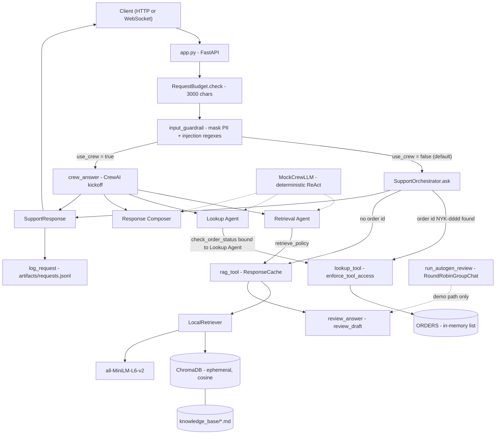
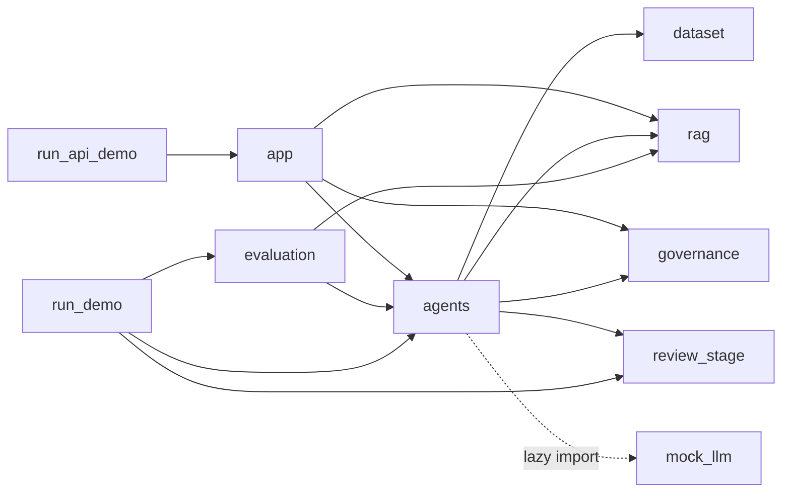
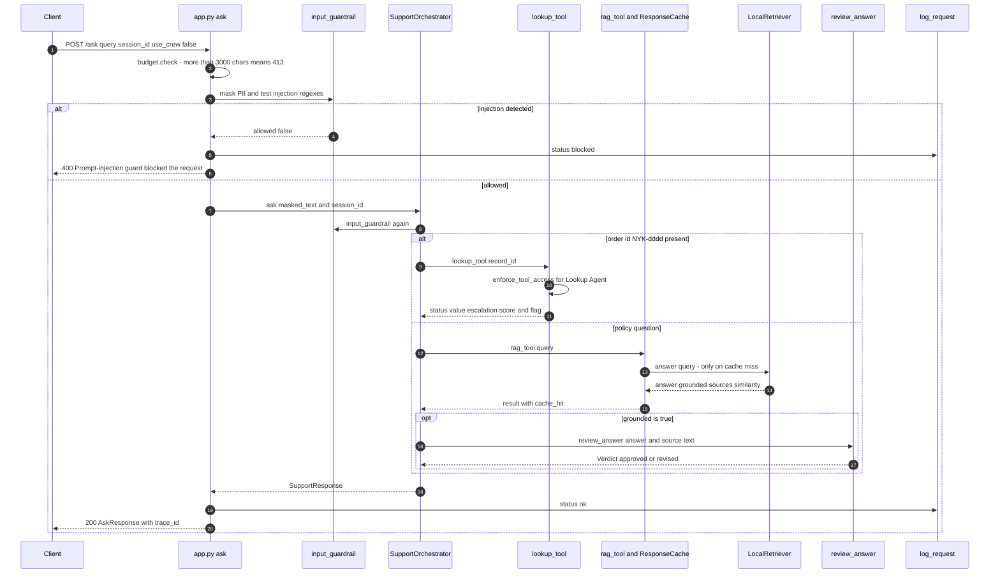
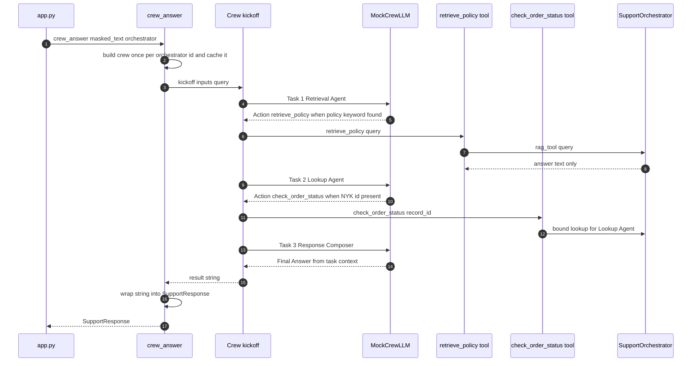
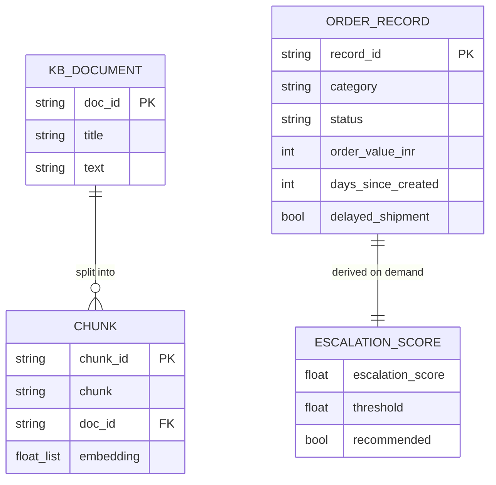

# Nykaa Domain Support Agent — Project Documentation

> Primary technical and functional reference for the repository. It documents the **current implementation**, not a proposed one.

**How this document was produced.** It is based on a full static read of every source file, the test suite, the CI workflow, `README.md`, the knowledge base, and the committed `artifacts/*` (which were generated by a real run on a Python 3.13 machine). No code was executed while writing it. Statements about runtime behaviour are therefore backed either by the source or by a committed artifact, and say which.

**Legend**

| Marker | Meaning |
|---|---|
| ✅ Confirmed | Verified in source code and/or a committed artifact |
| ⚠️ Inferred | Follows from the code but was not observed at runtime |
| ❓ Not verifiable | Cannot be established from the repository |
| 🚫 Not present | The feature or component does not exist in this repository |

**Terminology note.** The documentation brief mentions MongoDB, migrations, messaging, Docker and Kubernetes. This repository has **none of them** (see sections 7, 10 and 13). Those sections state this explicitly instead of inventing content.

---

## Table of contents

1. [Project Overview](#1-project-overview)
2. [Technology Stack](#2-technology-stack)
3. [System Architecture](#3-system-architecture)
4. [Project Structure](#4-project-structure)
5. [End-to-End Business Workflow](#5-end-to-end-business-workflow)
6. [API Documentation](#6-api-documentation)
7. [Database Design (data stores)](#7-database-design-data-stores)
8. [Data Transformation and Mapping](#8-data-transformation-and-mapping)
9. [Business Rules and Functional Scenarios](#9-business-rules-and-functional-scenarios)
10. [Integration Architecture](#10-integration-architecture)
11. [Error Handling and Logging](#11-error-handling-and-logging)
12. [Configuration Management](#12-configuration-management)
13. [Deployment and Execution](#13-deployment-and-execution)
14. [Testing Strategy](#14-testing-strategy)
15. [Known Limitations and Technical Debt](#15-known-limitations-and-technical-debt)
16. [Troubleshooting Guide](#16-troubleshooting-guide)
17. [Glossary](#17-glossary)
18. [Future Enhancements](#18-future-enhancements)

---

## 1. Project Overview

### 1.1 Purpose and objectives ✅

A customer-support agent for a fictional **Nykaa** (e-commerce, beauty and lifestyle) scenario. It answers two kinds of question:

1. **Policy questions** (return window, COD refunds, delivery SLA, warranty, and so on), answered from a self-authored knowledge base using retrieval-augmented generation (RAG).
2. **Order-status questions** ("check order NYK-0001"), answered from a synthetic, seeded order dataset, together with a designed **escalation score** that recommends whether a human should look at the order.

It was built as a capstone to the brief "Final Capstone — Nykaa Domain Support Agent (CrewAI)". The brief asks for one working, production-minded agent combining: dataset design, embeddings, vector retrieval, grounded generation, session memory, tool-calling agents, multi-agent orchestration, structured outputs, guardrails, evaluation, governance, cost control and a FastAPI deployment.

### 1.2 Business problem ✅

Support agents (and eventually customers) should get instant, grounded answers to routine policy and order questions instead of escalating everything to a human. The system must refuse to answer when the knowledge base does not support the question, must not leak fixed-format PII, and must resist prompt injection.

### 1.3 Business context and scope ✅

| In scope | Out of scope / not implemented |
|---|---|
| 13 illustrative policy documents; 50 synthetic orders | Real Nykaa policies or data (all content is fabricated and labelled illustrative) |
| Policy Q&A, order lookup, escalation recommendation | Any order mutation, payment, refund or account action (advisory only) |
| In-process session memory | Persistence across restarts |
| Keyless operation (`MOCK_LLM`) | Calls to any hosted LLM (a real model client can be swapped in, not required) |
| HTTP + WebSocket API, structured logs | Authentication, rate limiting, multi-tenant isolation |

### 1.4 Stakeholders and external systems ✅

| Party | Role |
|---|---|
| Capstone evaluators | Review the repository against the brief's 16 tasks and acceptance criteria |
| Developers / maintainers | Extend the agent, KB and API |
| Support agents (notional end users) | Would consume `/ask` and `/ws/chat` |

There are **no runtime external systems**. The one outbound network dependency is the one-time download of the embedding model `sentence-transformers/all-MiniLM-L6-v2` from the Hugging Face Hub on first use (no token required). ⚠️

### 1.5 High-level functionality ✅

- Seeded, validated order generator with a stated escalation formula and threshold.
- Two chunking strategies (fixed-with-overlap and sentence-based), each indexed in its own ChromaDB collection; calibrated "I don't know" threshold; precision/recall comparison.
- Deterministic router (`SupportOrchestrator`) **and** a real 3-agent CrewAI crew (run via `.kickoff()`), both returning one Pydantic schema (`SupportResponse`).
- Input guardrails (PII masking, prompt-injection regexes), output groundedness refusal, least-autonomy tool binding, request budget, response cache.
- Review stage: a deterministic reviewer on the request path, plus a real AutoGen `RoundRobinGroupChat` demonstrated separately.
- LangChain session memory, 15-query LLM-as-judge evaluation, FastAPI with HTTP + WebSocket, JSON-Lines request logging.

---

## 2. Technology Stack

### 2.1 Languages and runtimes ✅

| Item | Value | Evidence |
|---|---|---|
| Language | Python | all source is `.py` |
| Recommended version | 3.11 | `README.md`; CI `python-version: "3.11"` |
| Verified-working version | 3.13 | pytest traceback from the run machine shows `Python313` |

### 2.2 Libraries (`requirements.txt`) ✅

| Package | Constraint | Used for |
|---|---|---|
| `fastapi` | `>=0.115,<1.0` | HTTP and WebSocket API (`app.py`) |
| `uvicorn[standard]` | `>=0.30,<1.0` | ASGI server |
| `pydantic` | `>=2.8,<3.0` | Schemas (`SupportResponse`, API models, `Verdict`) — run machine used 2.12 ⚠️ |
| `numpy` | `>=1.26` | Listed; not imported directly by project code ⚠️ |
| `chromadb` | `>=0.5,<2.0` | Vector store (`rag.py`) |
| `sentence-transformers` | `>=3.0,<6.0` | Embeddings, model `all-MiniLM-L6-v2` |
| `crewai` | `==1.15.35` | Multi-agent orchestration (`agents.py`, `mock_llm.py`) |
| `autogen-agentchat` | `>=0.5,<0.6` | `RoundRobinGroupChat` review stage (`review_stage.py`) |
| `autogen-core` | `>=0.5,<0.6` | Model-client types used by the mock client |
| `langchain-core` | `>=0.3` | `InMemoryChatMessageHistory`, `RunnableWithMessageHistory` for `agents.MemoryChat` |
| `pytest` | `>=8.0` | Tests |
| `httpx` | `>=0.27` | Required by Starlette's `TestClient` |

> `langchain-core` was added to `requirements.txt` after the committed run (see L-1). Until `run_demo.py` is re-run in an environment that has it, the committed artifacts do not contain the memory transcript.

### 2.3 Other technology areas

| Area | Status |
|---|---|
| Build tool | 🚫 None (no `pyproject.toml`, `setup.py`, `Makefile`) |
| Database | 🚫 None. Data lives in process memory plus an ephemeral Chroma client (section 7) |
| Messaging infrastructure | 🚫 None |
| Deployment technologies | 🚫 No Dockerfile, Kubernetes or IaC. CI only: GitHub Actions (`.github/workflows/tests.yml`) |
| Third-party SaaS / APIs | 🚫 None required |

---

## 3. System Architecture

### 3.1 Components and responsibilities ✅

| Component | Module | Responsibility |
|---|---|---|
| API layer | `app.py` | HTTP/WebSocket endpoints, budget + guardrail enforcement, request logging |
| Orchestrator | `agents.SupportOrchestrator` | Deterministic router: guardrail → order lookup or RAG → review → `SupportResponse` |
| Crew | `agents.build_crewai_crew`, `crew_answer` | Real CrewAI crew (Retrieval, Lookup, Composer) wrapped into the same schema |
| Mock LLM for CrewAI | `mock_llm.MockCrewLLM` | Deterministic ReAct text so CrewAI runs without an API key |
| RAG core | `rag.LocalRetriever` | Chunking, embeddings, Chroma search, threshold, extractive answer |
| Dataset | `dataset.py` | Seeded orders, validation, escalation score and threshold |
| Governance | `governance.py` | Tool allow-list, request budget, response cache, risk classification |
| Review stage | `review_stage.py` | `review_draft` (request path) and AutoGen `run_autogen_review` (demo path) |
| Session memory | `agents.MemoryChat`, `SessionMemory` | LangChain history (follow-up resolution) and a write-only dict history |
| Evaluation | `evaluation.py` | 15 queries, judge prompt, `MockJudge`, four averages |
| Demos | `run_demo.py`, `run_api_demo.py` | Regenerate `artifacts/*` |

### 3.2 Architecture diagram ✅



### 3.3 Source and target systems ✅

| Direction | System | Notes |
|---|---|---|
| Source | `knowledge_base/*.md` | 13 Markdown policy documents read at retriever construction |
| Source | `dataset.generate_orders` | Seeded generator; no external data source |
| Target | HTTP/WebSocket clients | Receive `AskResponse` / `WSReply` |
| Target | `artifacts/requests.jsonl` | Append-only request log (git-ignored) |
| Target | `artifacts/*.txt, *.json` | Written by `run_demo.py` and `run_api_demo.py` |

---

## 4. Project Structure

Repository root is `nykaa-domain-support-agent/` (it holds `.gitignore`, `.github/` and the code). Any outer wrapper folder from a zip download is not part of the repository. ⚠️

```text
nykaa-domain-support-agent/
├── app.py                  FastAPI app: /health, /ask, /add-document, /ws/chat
├── agents.py               Guardrails, SupportResponse, SupportOrchestrator, CrewAI crew, MemoryChat
├── mock_llm.py             MockCrewLLM (deterministic CrewAI model)
├── rag.py                  Chunkers, LocalRetriever, threshold calibration, precision/recall
├── dataset.py              Seeded orders, escalation score and threshold
├── governance.py           Allow-list, RequestBudget, ResponseCache, risk constants
├── review_stage.py         Verdict, review_draft, MockReviewModelClient, run_autogen_review
├── evaluation.py           15-query LLM-as-judge harness (MockJudge)
├── run_demo.py             End-to-end demo; writes artifacts/*
├── run_api_demo.py         In-process API demo; writes artifacts/api_transcript.txt
├── conftest.py / pytest.ini  Put the project root on sys.path; testpaths = tests
├── requirements.txt        Dependencies
├── .env.example            Template (not loaded by any code, see section 12)
├── .gitignore              .venv, caches, .env, artifacts/*.jsonl
├── .github/workflows/tests.yml   CI: pip install, pytest -q on Python 3.11
├── knowledge_base/         13 policy documents (.md)
├── artifacts/              Committed run outputs (transcripts, metrics, orders)
├── tests/                  test_core.py, test_api_and_guards.py
```

### 4.1 Key classes, functions and constants

| File | Symbol | Role |
|---|---|---|
| `agents.py` | `mask_pii`, `input_guardrail` | PII masking and injection detection |
| | `SupportResponse` | Pydantic output schema (`intent` ∈ policy, order_status, mixed, unsupported, blocked) |
| | `check_order_status(record_id)` | The lookup tool; returns status, value and escalation fields |
| | `SupportOrchestrator` (`ask`, `rag_tool`, `lookup_tool`, `make_lookup_tool`) | Deterministic router and tool layer |
| | `build_crewai_crew`, `crew_answer`, `run_crewai_kickoff_demo` | CrewAI crew and its API wrapper |
| | `MemoryChat`, `resolve_followup`, `run_memory_demo` | LangChain memory |
| | `SessionMemory` | Plain dict history (written, never read for answers) |
| `rag.py` | `load_documents`, `fixed_chunks`, `sentence_chunks` | Ingestion and chunking |
| | `LocalRetriever` (`search`, `answer`) | Embeddings plus Chroma, lexical fallback |
| | `calibrated_threshold`, `precision_recall`, `relevance_for_query` | Calibration and metrics |
| `dataset.py` | `generate_orders`, `validate_orders`, `escalation_score`, `escalation_threshold`, `distribution` | Data and score |
| | `ORDERS`, `ESCALATION_THRESHOLD`, `SEED = 20261011` | Module-level constants built at import |
| `governance.py` | `enforce_tool_access`, `RequestBudget`, `ResponseCache`, `BudgetExceeded`, `UnauthorizedToolUse` | Controls and custom exceptions |
| `review_stage.py` | `Verdict`, `review_draft`, `review_answer`, `MockReviewModelClient`, `run_autogen_review` | Review stage |
| `evaluation.py` | `TEST_QUERIES`, `JUDGE_PROMPT`, `MockJudge`, `evaluate` | Evaluation |

### 4.2 Dependency graph ✅



Import-time side effects worth knowing: importing `dataset` generates and validates the 50 orders; importing `app` builds a global `SupportOrchestrator()` (loads the embedding model and indexes the KB); `agents.py` itself imports CrewAI lazily (inside functions), so `import agents` is cheap, but `mock_llm.py` imports CrewAI at module top.

---

## 5. End-to-End Business Workflow

The project has no ETL or batch integration. The "workflow" has two phases: **start-up** (build data and index) and **per-request** (answer a question). The headings from the documentation brief are mapped onto them below.

| Brief heading | Meaning in this repository |
|---|---|
| Source data extraction | `rag.load_documents()` reads `knowledge_base/*.md`; `dataset.generate_orders()` generates orders |
| Data processing / transformation | Chunking, embedding, masking, escalation scoring (section 8) |
| Validation | `validate_orders` (assertions), Pydantic models, `RequestBudget`, `input_guardrail` |
| Target system integration | Response to the HTTP/WebSocket client; no downstream system |
| Persistence | None for answers. Only `artifacts/requests.jsonl` (log) and committed demo artifacts |
| Error handling | Section 11 |
| Post-processing | Review stage (`review_answer`), response cache, `trace_notes` |
| Reconciliation | 🚫 No reconciliation process exists |

### 5.1 Start-up workflow ✅

1. **Import `dataset`** → `generate_orders(seed=20261011, n=50)` loops over seed offsets until the delayed-shipment rate is in 10–30%, then `validate_orders` asserts the structural contract. `ESCALATION_THRESHOLD = escalation_threshold()` is computed (80th percentile of the scores).
2. **Build `LocalRetriever(strategy)`** → `load_documents()` → `sentence_chunks` (default) or `fixed_chunks` → load `SentenceTransformer` → create/get Chroma collection → `collection.upsert(ids, documents, metadatas, embeddings)`. If chromadb or sentence-transformers cannot be imported or fail, the retriever sets `mode="lexical-fallback"` and uses a word-overlap cosine instead.
3. **`calibrated_threshold(retriever)`** runs lazily inside the first `answer()` call (and again on **every** call, see L-5): it measures top-1 similarity for 3 in-scope and 2 out-of-scope queries and sets the refusal threshold between the two clusters.

### 5.2 Request workflow, router path (default) ✅



Step detail (`app.ask` then `SupportOrchestrator.ask`):

1. `RequestBudget.check` rejects queries longer than `REQUEST_CHAR_BUDGET` (default 3000 characters) with HTTP 413.
2. `input_guardrail` masks PII, then tests five injection regexes on the lower-cased masked text; a hit returns HTTP 400.
3. `SupportOrchestrator.ask` runs the guardrail a second time (idempotent), then searches for `\bNYK-\d{4}\b`.
4. **Order branch:** `lookup_tool` calls `enforce_tool_access("Lookup Agent", "check_order_status")`, increments `tool_calls["lookup"]`, and calls `check_order_status`. Unknown IDs return the text "I couldn't find that order reference…" with `grounded=true`.
5. **Policy branch:** `rag_tool` increments `tool_calls["rag"]` (even on a cache hit) and calls `ResponseCache.get_or_compute(query, retriever.answer)`. If `grounded`, `review_answer(answer, ctx)` runs and its `final_answer` replaces the answer. Ungrounded results become `intent="unsupported"` and skip review.
6. The user turn (masked) and assistant turn are appended to `SessionMemory`. This history is **never read** to produce an answer (L-9).
7. `log_request` appends one JSON line, and the response is returned with a fresh `trace_id` (uuid4).

### 5.3 Request workflow, crew path (`use_crew: true`) ✅



Differences from the router path (all ✅ from the code and `api_transcript.txt`):

- The crew path does **not** call `review_answer`.
- `sources` is always `[]` (the `retrieve_policy` tool returns only the answer text).
- `crew_answer` re-reads order metadata by calling the module-level `check_order_status` directly (not through the bound tool) to fill `order_status` and `escalation_*`.
- `intent`/`grounded` are inferred: `grounded = "i don't know" not in text.lower()`.
- The router path formats currency as `₹16415`; the crew tool formats it as `Rs.16415`.

### 5.4 Error handling inside the workflow

See section 11. In short: budget → 413, injection → 400, schema errors → 422, unexpected exceptions on `/ask` are logged (`status="error"`) and re-raised (HTTP 500), and WebSocket errors become `WSError` frames without closing the socket.

---

## 6. API Documentation

Framework: FastAPI (`app = FastAPI(title="Nykaa Domain Support Agent", version="1.0.0")`). Auto-generated docs are available at `/docs` and `/openapi.json` (FastAPI defaults ⚠️). **Authentication and authorisation: none** (no middleware, no API keys, no CORS configuration).

### 6.1 Endpoint summary

| Method | Path | Request model | Response model | Purpose |
|---|---|---|---|---|
| GET | `/health` | none | `HealthResponse` | Liveness and retriever mode |
| POST | `/ask` | `AskRequest` | `AskResponse` | Answer one question (router or crew) |
| POST | `/add-document` | `AddDocumentRequest` | `AddDocumentResponse` | Add or replace a KB document (in memory) |
| WS | `/ws/chat` | JSON `AskRequest` frame | `WSReply` or `WSError` frame | Multi-turn chat |

### 6.2 `GET /health`

`app.health()` returns the status and the retriever mode.

```json
{"status": "ok", "rag_mode": "sentence-transformers+chromadb"}
```

`rag_mode` is `lexical-fallback` if the embedding stack could not be loaded. Source: `artifacts/api_transcript.txt`.

### 6.3 `POST /ask`

| Field | Type | Rules | Default |
|---|---|---|---|
| `query` | string | `min_length=1` | required |
| `session_id` | string | none | `"default"` |
| `use_crew` | boolean | selects crew path | `false` |

Processing: budget check → guardrail → (`crew_answer` or `orchestrator.ask`) → log → respond (section 5.2 and 5.3).

**Request**

```json
{"query": "Please check order NYK-0001", "session_id": "demo-1", "use_crew": false}
```

**Response 200** (from `artifacts/api_transcript.txt`)

```json
{
  "trace_id": "e25dcdc5-ef50-43be-930a-12106266f0a5",
  "answer": "Order NYK-0001 is Placed. Order value: ₹16415. Escalation score: 0.220. No escalation threshold reached.",
  "intent": "order_status",
  "grounded": true,
  "sources": [],
  "order_status": "Placed",
  "escalation_score": 0.22,
  "escalation_recommended": false,
  "trace_notes": ["Lookup Agent invoked check_order_status"]
}
```

**Policy example** (`intent: "policy"`, `sources` populated, review note present)

```json
{
  "answer": "For an eligible COD return, the customer must provide a supported bank account or approved refund method. After the returned item passes inspection, the illustrative refund target is 5–7 business days. Refund timing depends on payment method and payment-provider processing.",
  "intent": "policy", "grounded": true,
  "sources": ["cod-refunds", "cancellation", "privacy-and-pii"],
  "trace_notes": ["Retrieval Agent invoked RAG tool", "cache miss",
                  "review stage: approved=True | No unsupported claim detected; approved unchanged."]
}
```

**Error responses**

| Status | Trigger | Body |
|---|---|---|
| 400 | Injection regex matched | `{"detail": "Prompt-injection guard blocked the request."}` |
| 413 | `len(query) > REQUEST_CHAR_BUDGET` | `{"detail": "Request has 5000 characters; budget is 3000."}` |
| 422 | Pydantic validation (for example empty `query`) | FastAPI default error body |
| 500 | Any other exception (logged, then re-raised) | FastAPI default |

### 6.4 `POST /add-document`

Rebuilds the retriever with the new document and resets the response cache. The document text is passed through `mask_pii` and checked against the request budget.

| Field | Type | Rules |
|---|---|---|
| `doc_id` | string | length 1–100 |
| `title` | string | none |
| `text` | string | `min_length=10`; ≤ budget after masking |

```jsonc
// request
{"doc_id": "demo-note", "title": "Demo note", "text": "Illustrative demo policy for the API transcript."}
// response 200
{"trace_id": "29083edb-25ca-4f5d-a41e-ad17711f47b7", "status": "added", "doc_id": "demo-note",
 "note": "Index is in-memory and rebuilds locally; document is not persisted to disk."}
```

Errors: 413 (over budget), 422 (validation). Internals: takes `retriever_lock`, builds a new `LocalRetriever(strategy, documents=existing+new)` (this reloads the embedding model and re-embeds every document, L-6), assigns `orchestrator.cache = ResponseCache()`.

### 6.5 `WS /ws/chat`

Client sends JSON frames matching `AskRequest` (including `use_crew`). The server replies with one frame per request:

```jsonc
// success frame (WSReply, same fields as AskResponse)
{"trace_id": "7accafed-...", "answer": "Order NYK-0001 is Placed. ...", "intent": "order_status", "grounded": true, "sources": [], "order_status": "Placed", "escalation_score": 0.22, "escalation_recommended": false, "trace_notes": ["Lookup Agent invoked check_order_status"]}
// error frame (WSError)
{"trace_id": "06a9e32f-...", "error": "1 validation error for AskRequest\nquery\n  Field required [...]"}
```

| Situation | Behaviour |
|---|---|
| Invalid JSON or schema, budget exceeded, `TypeError`/`ValueError` | `WSError` frame, **socket stays open**, log status `rejected` |
| Injection detected | `WSError` "Prompt-injection guard blocked the request.", log `blocked` |
| Unexpected exception | `WSError` "Internal error.", log `error` |
| `WebSocketDisconnect` | Handler returns; other clients and the server are unaffected (demonstrated in `api_transcript.txt`: a new client is served after a disconnect) |

Blocking work (`orchestrator.ask` or `crew_answer`) runs via `run_in_threadpool` so the event loop is not blocked.

> ⚠️ Validation errors echo Pydantic's message (truncated to 300 characters), which includes a documentation URL. Minor information disclosure (L-12).

---

## 7. Database Design (data stores)

**There is no database.** 🚫 No MongoDB, SQL, migrations, schemas or connection strings exist in the repository, so there are no collections, tables, unique constraints or MongoDB queries to document. State lives in the following in-process or file stores.

| Store | Where | Lifetime | Identifier |
|---|---|---|---|
| Orders | `dataset.ORDERS` (list of dicts), also dumped to `artifacts/orders.json` | Regenerated deterministically at import | `record_id` (`NYK-0001` … `NYK-0050`) |
| KB documents | `knowledge_base/*.md`, loaded into `LocalRetriever.documents` | File on disk; in-memory copy per retriever | `doc_id` = file stem |
| Vector index | ChromaDB `chromadb.Client()` (ephemeral, in-process) | Process lifetime | chunk id `"{doc_id}-s-{i}"` or `"{doc_id}-f-{start}"` |
| Response cache | `ResponseCache._data` (dict) | Process lifetime; reset on `/add-document` | normalised query string |
| Session history (router) | `SessionMemory.history` (dict of lists) | Process lifetime | `session_id` |
| Session history (LangChain) | `MemoryChat.store` (dict of `InMemoryChatMessageHistory`) | Process lifetime | `session_id` |
| Request log | `artifacts/requests.jsonl` | Append-only file, git-ignored | `trace_id` (uuid4) |



`ESCALATION_SCORE` is computed, never stored.

### 7.1 Representative records

**Order** (`artifacts/orders.json`; sixth record):

```json
{"record_id": "NYK-0006", "category": "Apparel", "status": "Refunded",
 "order_value_inr": 17687, "days_since_created": 27, "delayed_shipment": true}
```

**KB document** (`knowledge_base/return-window.md`, loaded as `{doc_id, title, text}`):

```json
{"doc_id": "return-window", "title": "Return window by category",
 "text": "Illustrative policy: Beauty products may be returned within 7 days when unopened and in original packaging. ..."}
```

**Chroma record** (what `collection.upsert` receives per chunk; the embedding is a normalised 384-dimension vector from `all-MiniLM-L6-v2` ⚠️ dimension is a property of the model, not asserted in code):

```json
{"id": "return-window-s-0",
 "document": "Illustrative policy: Beauty products may be returned within 7 days ...",
 "metadata": {"doc_id": "return-window", "title": "Return window by category"},
 "embedding": [0.012, -0.044, "..."]}
```

**Request log line** (`app.log_request`):

```json
{"timestamp": "2026-11-17T09:30:12.481+00:00", "trace_id": "b66d1456-810b-417f-ac9c-02e5b8bf10da",
 "endpoint": "/ask", "duration_ms": 41.7, "status": "ok",
 "request_text": "My phone is [PHONE_MASKED], what is the COD refund time?"}
```

(Timestamp and duration values are illustrative; the field set is from the code. `status` ∈ `ok`, `blocked`, `budget_rejected`, `rejected`, `error`.)

**Cache entry** (`ResponseCache._data["what is the return window for beauty products?"]`): the dict returned by `LocalRetriever.answer` (`answer`, `grounded`, `similarity`, `sources`, `cache_hit`).

### 7.2 Query patterns

```python
# Vector search (rag.LocalRetriever.search)
qv = model.encode([query], normalize_embeddings=True).tolist()[0]
res = collection.query(query_embeddings=[qv], n_results=min(top_k, len(chunks)),
                       include=["documents", "metadatas", "distances"])
similarity = max(0.0, 1 - distance)        # collection uses hnsw:space = cosine
```

```python
# Order lookup (agents.check_order_status): linear scan, case-insensitive
for row in ORDERS:
    if row["record_id"].lower() == record_id.strip().lower(): ...
```

```powershell
# Inspect the request log (PowerShell)
Get-Content artifacts\requests.jsonl | ForEach-Object { $_ | ConvertFrom-Json } |
  Where-Object { $_.status -ne "ok" } | Format-Table timestamp, endpoint, status, trace_id
```

### 7.3 Indexes and constraints

| Item | Status |
|---|---|
| Vector index | Chroma HNSW with `{"hnsw:space": "cosine"}` metadata |
| Unique ids | Chroma enforces unique chunk ids (`upsert` overwrites on conflict) |
| `record_id` uniqueness | Guaranteed by construction (`f"NYK-{i+1:04d}"`); not enforced by a validator |
| Relational constraints, foreign keys | 🚫 Not applicable |

> ⚠️ The Chroma collection name is fixed per strategy (`nykaa_sentence_chunks` / `nykaa_fixed_chunks`) and created with `get_or_create_collection`. See L-3 for the stale-chunk risk.

---

## 8. Data Transformation and Mapping

### 8.1 Order generation (`dataset._generate_with_seed`)

| Field | Rule | Type |
|---|---|---|
| `record_id` | `NYK-` + zero-padded `i+1` (4 digits) | str |
| `category` | `CATEGORIES[i % 5]` for the first 15 records, then `rng.choice(CATEGORIES)` | str |
| `status` | `STATUSES[i]` for the first 5 records, then `rng.choice(STATUSES)` | str |
| `order_value_inr` | `rng.randint(299, 24999)`, uniform across all categories | int |
| `days_since_created` | `rng.randint(0, 30)` | int |
| `delayed_shipment` | `rng.random() < 0.20` | bool |

Retry rule: if the delayed rate is outside 10–30%, increment the seed offset (up to 100 attempts) and regenerate; records are never hand-edited. Committed result: seed `20261011`, offset 0, 7 of 50 delayed (14.0%).

### 8.2 Knowledge base to retrieval records

| Step | Transformation | Function |
|---|---|---|
| 1 | Read file; title = first line starting `# `, else file stem; body = all lines not starting with `#` | `load_documents` |
| 2a | **Sentence strategy:** split on `(?<=[.!?])\s+`, group 2 sentences per chunk, id `{doc_id}-s-{i}` | `sentence_chunks` |
| 2b | **Fixed strategy:** 320-char windows with 60-char overlap, strip whitespace, id `{doc_id}-f-{start}` | `fixed_chunks` |
| 3 | Embed chunk text with `all-MiniLM-L6-v2`, `normalize_embeddings=True` | `LocalRetriever.__init__` |
| 4 | Upsert `ids / documents / metadatas {doc_id, title} / embeddings` | `collection.upsert` |

The lexical fallback tokenises with a small stop-word list and a naive stemmer (`ies→y`, `ing`, `ed`, trailing `s`), then uses cosine similarity over token counts.

### 8.3 Retrieval result to API response

| Source (`LocalRetriever.answer`) | Target (`SupportResponse`) | Rule |
|---|---|---|
| `answer` | `answer` | Join the text of the top **2** hits (may be replaced by the review stage's `final_answer`) |
| `grounded` | `grounded`; `intent` | `intent = "policy"` if grounded else `"unsupported"` |
| `sources` | `sources` | Unique `doc_id` of all top-3 hits (can include documents whose chunk was not used in the answer) |
| `cache_hit` | `trace_notes` | `"cache hit"` or `"cache miss"` |
| `similarity` | not exposed | Used only for the threshold decision |

Refusal rule: if there are no hits or `hits[0].similarity < threshold`, return the fixed text "I don't know based on the available policy documents. Please contact customer support for confirmation." with `grounded=false`, `sources=[]`.

### 8.4 Order lookup to API response

| `check_order_status` key | `SupportResponse` field | Notes |
|---|---|---|
| `status` | `order_status` | |
| `escalation_score` | `escalation_score` | rounded to 3 decimals |
| `escalation_recommended` | `escalation_recommended` | `score >= ESCALATION_THRESHOLD` |
| `record_id`, `order_value_inr`, `escalation_score` | `answer` text | `"Order {id} is {status}. Order value: ₹{value}. Escalation score: {score:.3f}. ..."` |
| `error` ("Order not found") | `answer` "I couldn't find that order reference…" | `intent="order_status"`, `grounded=true` |
| `days_since_created`, `delayed_shipment`, `escalation_threshold` | returned by the tool, not copied to the response | |

### 8.5 Escalation score ✅

```text
recency        = min(1.0, days_since_created / 30)
status_factor  = 1.0 if status in {Placed, Shipped} else 0.5
score          = round(clamp(status_factor * (0.4 * delayed_shipment + 0.6 * recency), 0, 1), 3)
threshold      = 80th percentile of all 50 scores (linear interpolation) = 0.38
recommended    = score >= threshold            (13 of 50 orders in the committed data)
```

Worked examples from `artifacts/orders.json`:

| Order | Status | Days | Delayed | Score | Recommended |
|---|---|---|---|---|---|
| NYK-0001 | Placed | 11 | no | 0.220 | no |
| NYK-0002 | Shipped | 1 | yes | 0.420 | **yes** |
| NYK-0017 | Shipped | 27 | no | 0.540 | **yes** |
| NYK-0016 | Shipped | 19 | no | 0.380 | **yes** (equals threshold) |
| NYK-0035 | Delivered | 30 | yes | 0.500 | **yes** (resolved order, still flagged) |
| NYK-0032 | Refunded | 30 | no | 0.300 | no |

Because `>=` is used and several scores tie at 0.38, 13 orders (26%) are flagged rather than exactly 20%. The threshold is derived from the same data it is applied to. `delayed_shipment` and recency both contribute, so the score is not a boolean of the delay flag.

### 8.6 PII masking (`agents.mask_pii`) ✅

Applied in this order, on the text the model and the logs see:

| Order | Pattern (`agents.py`) | Replacement | Example |
|---|---|---|---|
| 1 | `PHONE_RE`: optional `+91`/`91`, then `[6-9]\d{9}`, not adjacent to other digits | `[PHONE_MASKED]` | `9876543210` |
| 2 | `FULL_CARD_RE`: 12–15 digits (optional space/hyphen separators) followed by 4 digits | `[CARD_MASKED]` | `4111111111111111` |
| 3 | `CARD_RE`: the word `card` (optionally `last-4`, `ending`, `ending in`) then 4 digits | keeps the prefix, masks digits → `[LAST4_MASKED]` | `card ending in 1234` |

Names and addresses are **not** masked (documented limitation; only fabricated values are to be used).

### 8.7 Crew result to API response (`agents.crew_answer`)

| Condition | `intent` | `grounded` | Other fields |
|---|---|---|---|
| Query contains a known `NYK-dddd` | `order_status` | `true` | `order_status`, `escalation_score`, `escalation_recommended` from `check_order_status` |
| Otherwise, text lacks "i don't know" | `policy` | `true` | `sources=[]` |
| Otherwise | `unsupported` | `false` | `sources=[]` |

---

## 9. Business Rules and Functional Scenarios

### 9.1 Policy content in the knowledge base (illustrative, fabricated) ✅

All values below come from `knowledge_base/*.md` and are explicitly labelled illustrative. They are data, not code logic.

| `doc_id` | Topic | Key content |
|---|---|---|
| `return-window` | Return window | Beauty 7 days (unopened, original packaging); Apparel and Footwear 10 days (unused, tags); Home and Electronics 7 days, subject to exclusions |
| `cod-refunds` | COD refunds | Needs a supported bank account or refund method; target 5–7 business days after inspection |
| `delivery-sla` | Delivery | 3–7 business days after dispatch; estimate is not a guarantee |
| `reverse-pickup` | Reverse pickup | Only eligible PIN codes and return reasons; item packed safely with accessories |
| `warranty` | Warranty | Electronics per manufacturer and listing (keep invoice and serial); Home per product page; Beauty/Apparel/Footwear generally none |
| `cancellation` | Cancellation | Allowed while `Placed` and before fulfilment; after shipping, use the return process |
| `loyalty-points` | Loyalty points | Qualifying items only; no cash exchange; may exclude shipping, brands, bundles |
| `payment-retry` | Payment failure | Check for a debit before retrying; avoid repeated attempts; share the order reference with support if still debited |
| `size-exchange` | Size exchange | Apparel and Footwear, size in stock, item unused with tags |
| `damaged-claim` | Damaged item | Report promptly; keep packaging, invoice, labels; send photos via approved channel |
| `international-shipping` | International | Domestic only; no promise of cross-border delivery |
| `escalation-matrix` | Escalation | Routine questions to first-line; payment loss, repeated refund failures, damaged high-value electronics, privacy incidents, high delay score go to the specialist queue; suspected fraud to security/payments |
| `privacy-and-pii` | Privacy | Minimum necessary data; phone and card last-4 masked; names/addresses cannot be masked |

> Product-specific handling therefore lives in the KB text (categories Beauty, Apparel, Footwear, Home, Electronics). **There is no plan, tier or subscription concept** in the repository. 🚫

### 9.2 Rules implemented in code ✅

| Rule | Implementation |
|---|---|
| Refuse unsupported questions | `LocalRetriever.answer` returns the fallback when top-1 similarity is below the calibrated threshold (≈0.315 fixed, ≈0.314 sentence in the committed run) |
| Threshold calibration | midpoint between the max out-of-scope and min in-scope top-1 similarity if separable, else the min in-scope value |
| Block prompt injection | five regexes in `INJECTION_REGEXES` (ignore/disregard previous instructions, reveal system prompt, bypass guardrails, act as unrestricted) |
| Mask PII before model and log | `mask_pii` (8.6); applied to API input, stored memory and log text |
| Least autonomy | `enforce_tool_access` allow-list `{"Lookup Agent": {"check_order_status"}}`; `make_lookup_tool(agent_name)` binds identity at wiring time |
| Request cost cap | `RequestBudget(max_chars=3000)`; character count, not tokens |
| Response caching | `ResponseCache` keyed by `re.sub(r"\s+"," ",query.strip().lower())`; hit avoids `retriever.answer`; cleared on `/add-document` |
| Review of policy answers | `review_draft`: if the text contains `guaranteed delivery tomorrow`, `will definitely refund`, `official nykaa policy guarantees` or `guaranteed to arrive`, return `approved=false` with the claim removed; otherwise approve unchanged. The context argument is ignored |
| Order-id detection | regex `\bNYK-\d{4}\b`, case-insensitive; the first match wins |
| Risk classification | `governance.RISK_CLASSIFICATION = "Medium"` (customer-support tool, advisory only) |
| Follow-up resolution (LangChain path only) | `resolve_followup`: "What about <Category>?" swaps the category in the last prior user turn that has one; "it / my order / that order" without an id appends the last order id from history; no history → clarification request |

### 9.3 Functional scenarios

| Scenario | Behaviour | Evidence |
|---|---|---|
| Normal policy question | Grounded extractive answer, sources, review note | `demo_transcript.txt`, `api_transcript.txt` |
| Normal order lookup | Status, value, escalation score, recommendation | `api_transcript.txt` |
| Unknown order id (for example `NYK-9999`) | "I couldn't find that order reference…", `intent=order_status` | `tests/test_core.py::test_order_lookup` covers the tool |
| Out-of-scope question | Fallback text, `intent=unsupported`, `grounded=false` | `demo_transcript.txt` "OUTPUT GROUNDEDNESS GUARD" |
| Prompt injection | `/ask` → HTTP 400; `ask()` → `intent=blocked`; WebSocket → error frame | `api_transcript.txt` |
| PII in query | Masked before processing and logging; request still answered | `demo_transcript.txt`, test `test_ask_ok_blocked_budget_and_masked_log` |
| Oversized request | HTTP 413 / WebSocket error frame | `api_transcript.txt` |
| Unauthorised tool use | `UnauthorizedToolUse` for Response Composer and Retrieval Agent; allowed for Lookup Agent | `demo_transcript.txt` |
| Ungrounded claim in a draft | Revised by the reviewer (`approved=false`) | `autogen_transcript.txt`, `demo_transcript.txt` |
| Repeated identical query | Cache hit; `calls` unchanged, `hits` +1 (`calls=3, hits 2→3`) | `demo_transcript.txt` |
| Same `doc_id` added again | Replaces the earlier document (`existing` filtered by `doc_id`) | `app.add_document` |
| Duplicate detection of orders | 🚫 None; ids are unique by construction |
| Retry scenarios | 🚫 No retries anywhere in the code |
| Data consistency | Orders are deterministic per seed; the index is rebuilt in memory, so there is no persisted state to drift |

---

## 10. Integration Architecture

There is no system-to-system integration at runtime. Every "integration" below is an in-process library or a one-time model download. 🚫 No REST, SOAP, SFTP, queue or database connections exist.

| Integration | Purpose | Protocol | Authentication | Configuration | Failure behaviour | Retry / timeout |
|---|---|---|---|---|---|---|
| Hugging Face Hub (`all-MiniLM-L6-v2`) | Embedding model download on first use | HTTPS (handled by the library) | None (public model) | Model name hard-coded in `LocalRetriever.__init__` | Any exception in the `try` block sets `mode="lexical-fallback"` and stores `fallback_reason`; the app keeps running with lower retrieval quality | None in project code |
| ChromaDB | Vector search | In-process (`chromadb.Client()`, ephemeral) | None | Collection `nykaa_{strategy}_chunks`, cosine space | Same fallback as above | n/a |
| CrewAI 1.15.35 | Multi-agent orchestration | In-process | None; model is `MockCrewLLM` (subclass of `crewai.llms.base_llm.BaseLLM`) | Agents built in `build_crewai_crew`; telemetry disabled via env vars | Exceptions inside `kickoff` propagate: `/ask` logs `error` and returns 500; the WebSocket sends `Internal error.` | None |
| AutoGen AgentChat 0.5.x | Review team | In-process; `MockReviewModelClient` implements the model-client interface | None | `RoundRobinGroupChat(max_turns=2, custom_message_types=[StructuredMessage[Verdict]])` | `run_autogen_review` raises `RuntimeError` if no `Verdict` is produced; `_autogen_review_sync` swallows any exception and falls back to `review_draft` silently (L-8) | None |
| LangChain core | Session history | In-process | None | `RunnableWithMessageHistory(RunnableLambda(step), get_history, ...)` | `ImportError` if `langchain-core` is absent (see L-1) | n/a |

**Swapping in a real model (optional, not implemented):** pass an `llm=` object to `build_crewai_crew(orchestrator, llm=...)` and a real `ChatCompletionClient` to `run_autogen_review(..., model_client=...)`. Both parameters exist; nothing in the repository configures them, and any API key handling would be new code. ❓ Behaviour with a real model is untested.

---

## 11. Error Handling and Logging

### 11.1 Strategy ✅

Errors are handled at the API boundary; the core modules raise and let the caller decide.

| Source | Exception | Where raised | Handling |
|---|---|---|---|
| Oversized input | `BudgetExceeded(ValueError)` | `RequestBudget.check` | `/ask`, `/add-document` → HTTP 413; WebSocket → `WSError` frame |
| Unauthorised tool call | `UnauthorizedToolUse(PermissionError)` | `enforce_tool_access` | Not caught by the API; reaches callers of the bound tool (demonstrated in `run_demo.py`) |
| Injection | none (flag in the guardrail result) | `input_guardrail` | `/ask` → `HTTPException(400)`; `ask()` → `intent="blocked"` |
| Bad schema | `pydantic.ValidationError` | FastAPI / `AskRequest(**payload)` | HTTP 422; WebSocket → `WSError`, socket stays open |
| Dataset contract | `AssertionError`, `RuntimeError`, `ValueError` | `validate_orders`, `generate_orders` | Fails at import time (no handling) |
| Embedding stack failure | any `Exception` | `LocalRetriever.__init__` | Caught; falls back to lexical retrieval |
| Empty AutoGen verdict | `RuntimeError` | `run_autogen_review` | Propagates (demo); swallowed by `_autogen_review_sync` |
| Anything else on `/ask` | `Exception` | `app.ask` | Logged as `error`, then re-raised (HTTP 500) |

Custom exceptions are only `BudgetExceeded` and `UnauthorizedToolUse` (`governance.py`).

### 11.2 Logging ✅

- **Framework:** none. The Python `logging` module is not used; `app.log_request` appends JSON Lines to `LOG_PATH`.
- **Log levels:** none (no severity field). `status` plays the role of outcome.
- **Fields:** `timestamp` (UTC ISO-8601), `trace_id` (uuid4), `endpoint`, `duration_ms`, `status`, `request_text` (PII-masked).
- **Coverage:** `/ask`, `/add-document` and every `/ws/chat` message (`ok`, `blocked`, `rejected`, `error`; `/ask` also writes `budget_rejected`).
- **PII rule:** the logged text goes through `mask_pii`, so fixed-format phone and card values never reach disk in the clear. Verified by `test_ask_ok_blocked_budget_and_masked_log`.
- **Debug log:** with `MOCK_LLM_DEBUG=1`, `mock_llm.py` appends prompts to `artifacts/crewai_debug.log`. This file must not be committed (it may contain request text).
- **Rotation / shipping / alerting:** 🚫 not implemented.

### 11.3 Retry and recovery

🚫 No retry, back-off, circuit breaker or timeout exists. The only recovery mechanism is the lexical fallback retriever and the "I don't know" refusal.

### 11.4 Monitoring and troubleshooting

Use `trace_id` from the response to find the matching log line, filter on `status`, and compare `duration_ms`. `/health` reports `rag_mode`. `trace_notes` in each response show which tool ran, cache hit or miss, and the review verdict.

---

## 12. Configuration Management

### 12.1 Environment variables actually read by code ✅

| Variable | Read in | Default | Purpose |
|---|---|---|---|
| `REQUEST_CHAR_BUDGET` | `app.py` | `3000` | Maximum request characters |
| `LOG_PATH` | `app.py` | `artifacts/requests.jsonl` | JSONL log file (relative to the working directory) |
| `MOCK_LLM_DEBUG` | `mock_llm.py` | unset | `1` writes `artifacts/crewai_debug.log` |
| `CREWAI_DISABLE_TELEMETRY` | set via `os.environ.setdefault(..., "true")` in `app.py`, `run_demo.py`, `run_api_demo.py` | `true` | Avoid CrewAI telemetry |
| `OTEL_SDK_DISABLED` | set the same way | `true` | Disable OpenTelemetry |

### 12.2 Variables that exist but are not consumed ✅

| Variable | Where | Reality |
|---|---|---|
| `MOCK_LLM` | `.env.example`; `os.environ.setdefault("MOCK_LLM","1")` in demo scripts | **Never read.** Mock behaviour is hard-wired, not switched by this flag |
| `RAG_TOP_K`, `RAG_MIN_SIMILARITY` | `.env.example` only | **Never read** (`top_k=3` is a default argument; the threshold is calibrated). Setting `RAG_MIN_SIMILARITY` has no effect |

There is no `python-dotenv` (or other) loader, so a `.env` file is not read; variables must be exported in the shell.

### 12.3 Hard-coded configuration ✅

| Item | Value | Location |
|---|---|---|
| Embedding model | `sentence-transformers/all-MiniLM-L6-v2` | `rag.py` |
| Chunking | fixed 320 chars / 60 overlap; sentences ×2 | `rag.fixed_chunks`, `sentence_chunks` |
| Retrieval | `top_k=3`; answer joins top 2 chunks | `LocalRetriever.search/answer` |
| Calibration queries | 3 in-scope, 2 out-of-scope | `rag.calibrated_threshold` |
| Seed / size | `20261011` / 50 | `dataset.py` |
| Escalation weights / percentile | `0.4`, `0.6`, status factor `0.5`, 80th percentile | `dataset.py` |
| Default retriever strategy | `"sentence"` | `SupportOrchestrator.__init__` |
| Risky-claim phrases | four phrases | `review_stage.RISKY_CLAIMS` |
| Allow-list | `{"Lookup Agent": {"check_order_status"}}` | `governance.enforce_tool_access` |
| Crew process | `Process.sequential`, 3 agents, 3 tasks | `build_crewai_crew` |

### 12.4 Secrets and credentials ✅

None are required or stored. The repository contains no API keys, tokens or passwords, and `.gitignore` excludes `.env`. If a real model client were added, its credentials would be new configuration.

---

## 13. Deployment and Execution

### 13.1 Prerequisites

Python 3.11 (recommended), network access on first run (model download), and enough disk and RAM for PyTorch (pulled in by `sentence-transformers`).

### 13.2 Local setup and run ✅ (commands from `README.md`)

```powershell
python -m venv .venv
.venv\Scripts\activate                  # Windows; use source .venv/bin/activate on macOS/Linux
pip install -r requirements.txt         # includes langchain-core
pytest -q                               # unit and API/WebSocket tests
python run_demo.py                      # end-to-end demo; regenerates artifacts
python run_api_demo.py                  # in-process API demo; writes api_transcript.txt
uvicorn app:app --reload                # serve on http://127.0.0.1:8000 (docs at /docs)
```

Run everything from the repository root: `LOG_PATH` and `artifacts/` are relative paths.

| Command | Writes |
|---|---|
| `python run_demo.py` | `artifacts/demo_transcript.txt`, `rag_metrics.json`, `evaluation.json`, `orders.json`, `crew_transcript.txt`, `autogen_transcript.txt`, and `memory_transcript.txt` (only if `langchain-core` is installed) |
| `python run_api_demo.py` | `artifacts/api_transcript.txt` |
| running the API | `artifacts/requests.jsonl` (git-ignored) |

### 13.3 CI ✅

`.github/workflows/tests.yml` runs on push and pull request: `ubuntu-latest`, Python 3.11, `pip install -r requirements.txt`, `pytest -q`. Since `langchain-core` is now in `requirements.txt`, the memory test runs instead of being skipped by `pytest.importorskip` (⚠️ not yet observed in CI).

### 13.4 Docker, Kubernetes, environments

🚫 No Dockerfile, compose file, Helm chart or EKS/Kubernetes configuration exists, and there is no environment-specific configuration (dev/staging/prod). Deployment beyond local `uvicorn` is ❓ undefined.

Considerations if deployed (⚠️ inferred from the code):

- State is per process. With several uvicorn workers, each has its own orchestrator, cache, memory and Chroma index; `/add-document` on one worker does not reach the others.
- Start-up loads the embedding model and indexes the KB at import time (`app.py`), so start-up is slow and memory-heavy.
- Requests are unauthenticated; do not expose the service publicly as is.

---

## 14. Testing Strategy

### 14.1 Frameworks and layout ✅

pytest (`pytest.ini`: `pythonpath = .`, `testpaths = tests`), `conftest.py` inserts the project root into `sys.path`. API tests use FastAPI's `TestClient` (needs `httpx`).

| File | Collected? | Tests |
|---|---|---|
| `tests/test_core.py` | yes | 7: dataset contract, PII and injection, order lookup, budget and least-autonomy, KB chunking, review revision, structured response |
| `tests/test_api_and_guards.py` | yes | 13: escalation not a bare boolean, card/phone masking, injection variants, tool bound to agent identity, out-of-scope refusal, `/ask` 200/400/413 with masked log, `/add-document` cache reset and logging, WebSocket error handling and disconnect/reconnect, follow-up resolution, LangChain memory carry/reset (`importorskip`), 15-row evaluation, `/ask` with `use_crew`, `crew_answer` returns `SupportResponse` |

### 14.2 Mocking and test data

- No mocks library. "Mocking" is architectural: `MockCrewLLM`, `MockReviewModelClient` and `MockJudge` are the production code path under `MOCK_LLM`.
- The `client` fixture monkeypatches `app.LOG_PATH` to a temp file.
- Test data: the seeded `ORDERS`, the 13 KB documents, and literal queries.

### 14.3 Known testing limitations

- The crew-through-API tests were moved into `tests/` (L-2) but have not been run since the move. `review_stage.run_autogen_review` and `mock_llm` have no direct tests; the AutoGen team is exercised only by `run_demo.py`.
- No tests for `precision_recall`, the lexical fallback retriever, `ResponseCache` hits, or the dataset reseed loop.
- Tests share module-level state (`app.orchestrator`); `test_add_document_clears_cache_and_logs` replaces the global retriever and later tests run against it. Order-dependence is ⚠️ possible.
- Several tests build a full `SupportOrchestrator` (model load), so the suite is slow.
- `test_escalation_is_not_a_bare_boolean` uses a loose assertion (`max(on_time) > min(delayed) or max(on_time) > 0.3`).
- Verification evidence from the run machine: the user reported `pytest` and `run_demo.py` succeeded; the committed transcripts are the observable proof.

---

## 15. Known Limitations and Technical Debt

"Actual" means observable in the repository; "Recommendation" means a suggested change.

| ID | Type | Finding | Evidence / location |
|---|---|---|---|
| L-1 | **Partly resolved** | `langchain-core>=0.3` is now in `requirements.txt`. The **committed** `demo_transcript.txt` still records `SESSION MEMORY unavailable: ModuleNotFoundError("No module named 'langchain_core'")` and `artifacts/memory_transcript.txt` does not exist yet. The README says that file exists. Needs a re-run of `python run_demo.py` with `langchain-core` installed, then commit the new artifacts | `requirements.txt`; `artifacts/demo_transcript.txt` |
| L-2 | **Resolved in code** | The stray root-level `test_api_and_guards.py` was deleted and its two crew tests were moved into `tests/test_api_and_guards.py` (now 13 tests). Not yet run after the move | `tests/` |
| L-3 | **Actual** ⚠️ | `get_or_create_collection` with a fixed name per strategy. Re-indexing in the same process (for example `/add-document` replacing a document with shorter text) can leave stale chunk ids, and two retrievers of one strategy share a collection | `rag.LocalRetriever.__init__` |
| L-4 | **Actual** | Answer composition joins the top 2 chunks regardless of the second chunk's similarity; `sources` lists all top-3 documents; fixed chunks can cut mid-word. The committed transcript shows "…re to the specialist queue" and "Any suspected fraud or exposed p" | `rag.answer`; `demo_transcript.txt` (fixed strategy) |
| L-5 | **Actual** | `calibrated_threshold` runs on every `answer()` call, and each calibration query is searched twice (about 10 searches per answer) | `rag.calibrated_threshold` |
| L-6 | **Actual** | Each `LocalRetriever` construction reloads the embedding model; `/add-document` therefore re-embeds the whole corpus and reloads the model. Nothing is persisted | `rag.py`, `app.add_document` |
| L-7 | **Actual** | Crew path: no review step, `sources` always empty, `intent`/`grounded` inferred from text, one `Crew` object reused across requests and threads (thread-safety ❓ unverified), and a direct (non-bound) `check_order_status` call | `agents.crew_answer`; `api_transcript.txt` |
| L-8 | **Actual** | The request-path reviewer (`review_draft`) ignores the context and checks four phrases. The AutoGen team runs only in the demo. `_autogen_review_sync` swallows every exception. The README risk section says the AutoGen review approves or revises answers "before release", which overstates the request path | `review_stage.py`; `README.md` |
| L-9 | **Actual** | `SessionMemory` is write-only; real memory exists only in `MemoryChat`, which no API endpoint uses. `session_id` is client-supplied | `agents.py`, `app.py` |
| L-10 | **Actual** | `MockCrewLLM`, `MockReviewModelClient` and `MockJudge` are scripted. Judge scores are partly true by construction (answers are extracted from the context, so grounding is 5.0). Averages: accuracy 5.0, grounding 5.0, completeness 3.62, safety 5.0 | `evaluation.py`; `demo_transcript.txt` |
| L-11 | **Actual** | Guardrail scope: names and addresses are not masked; injection detection is five regexes; `FULL_CARD_RE` false positives (long digit strings) are ❓ untested | `agents.py` |
| L-12 | **Actual** | WebSocket validation errors echo Pydantic's message and documentation URL | `app.websocket_chat` |
| L-13 | **Actual** | No authentication, rate limiting or CORS policy; one global orchestrator, cache and retriever shared by all callers | `app.py` |
| L-14 | **Actual** | Dead or misleading configuration: `MOCK_LLM`, `RAG_TOP_K`, `RAG_MIN_SIMILARITY` are never read; no `.env` loader | `.env.example` |
| L-15 | **Actual** | Budget is character-based, not token-based; validation uses `assert` (stripped under `python -O`); `numpy` is listed but unused; heavy import-time initialisation | `governance.py`, `dataset.py`, `app.py` |
| L-16 | **Actual** | Escalation threshold is the 80th percentile of the same 50 orders and `>=` with ties flags 13 (26%); resolved orders can still be flagged (NYK-0035) | `dataset.py`; section 8.5 |
| L-17 | **Actual** | Documentation drift in `README.md`: the intro says "12-topic policy knowledge base" (there are 13 documents) and calls CrewAI/AutoGen "adapters"; the Layout section still describes `agents.py` as an "optional CrewAI crew factory" and `review_stage.py` as an "optional AutoGen ... adapter"; the Limitations section calls the integrations "optional adapters". `project_docs/` is not in the repository, so the README's references to design notes cannot be followed | `README.md` |
| L-18 | **Actual** (cosmetic) | `demo_transcript.txt` prints the `=== CREWAI CREW (.kickoff()) ===` header twice | `run_demo.py` |
| L-19 | Recommendation | CI installs the full PyTorch stack on every run; consider caching or a lighter test profile | `.github/workflows/tests.yml` |
| L-20 | Recommendation | Re-run `python run_demo.py` and `python run_api_demo.py` after installing the updated requirements, and commit the regenerated `artifacts/` (adds `memory_transcript.txt`) | see L-1 |

---

## 16. Troubleshooting Guide

| Symptom | Likely cause | Check | Resolution |
|---|---|---|---|
| `ModuleNotFoundError: No module named 'app'` (or `dataset`) when running pytest | Project root not on `sys.path`, or wrong working directory | `pytest.ini` has `pythonpath = .`; run from the repo root | Run `pytest -q` from the repository root |
| `=== SESSION MEMORY unavailable: ModuleNotFoundError ... langchain_core` in the transcript; no `memory_transcript.txt` | `langchain-core` not installed in that environment (L-1) | `pip show langchain-core` | `pip install -r requirements.txt` (now includes it), then re-run `python run_demo.py` |
| `/health` shows `"rag_mode": "lexical-fallback"` | `chromadb` or `sentence_transformers` failed to import or the model could not be downloaded | `LocalRetriever.fallback_reason`; network; `pip show chromadb sentence-transformers` | Install the packages, ensure Hugging Face access, restart |
| `ImportError` on `crewai.llms.base_llm` or `crewai.events...` | CrewAI version differs from the pin | `pip show crewai` | Install `crewai==1.15.35` |
| `=== CREWAI CREW (.kickoff()) unavailable: ...` or `AutoGen review demo unavailable: ...` in the transcript | The demo catches failures and continues, so the script still exits successfully | Read the exception text on that line | Fix the named import or version problem, re-run |
| Transcript shows old values (for example an old escalation score) | Stale `__pycache__` or running from a different copy of the project | Compare `inspect.getsourcefile(agents)` with the intended folder | Delete `__pycache__` folders; run from the correct folder |
| HTTP 400 for a harmless query | An injection regex matched (for example "ignore previous instructions") | `input_guardrail(text)["reason"]` | Rephrase; adjust `INJECTION_REGEXES` if a false positive |
| HTTP 413 | Query longer than `REQUEST_CHAR_BUDGET` | Response detail shows the count | Shorten the query or set `REQUEST_CHAR_BUDGET` |
| WebSocket frame `{"error": "1 validation error for AskRequest ..."}` | Payload missing `query` | Frame text | Send `{"query": "...", "session_id": "..."}` |
| Answer contains unrelated sentences or cut-off words | L-4 (top-2 chunk join, fixed chunking) | `sources` and `similarity` | Prefer the `sentence` strategy (the default) |
| Stale answer after `/add-document` | Cache not cleared (should be) or stale Chroma chunks (L-3) | `GET /health`; restart the process | Restart; delete and recreate the collection |
| No log file | `LOG_PATH` is relative to the working directory | `Test-Path artifacts\requests.jsonl` from the repo root | Run from the repo root or set an absolute `LOG_PATH` |
| `UnicodeEncodeError` printing `₹` or `–` on Windows | cp1252 console | `run_demo.py` reconfigures stdout to UTF-8 | Set `PYTHONUTF8=1` for other scripts |
| Slow first request or start-up | Model download and indexing at import | Console during start | Wait for the first download; keep the process running |
| `pip install` resolution errors | Dependency conflicts between CrewAI, chromadb and AutoGen pins | `pip install -r requirements.txt` output (the last lines name the conflict) | Use a clean virtual environment; Python 3.11 is the documented target. The cause of an install failure reported during development was ❓ not captured |

---

## 17. Glossary

| Term | Meaning in this project |
|---|---|
| RAG | Retrieval-augmented generation: retrieve KB chunks, then answer only from them |
| Grounded | The answer is supported by retrieved text (top-1 similarity ≥ threshold) |
| Calibrated threshold | Refusal cut-off placed between measured in-scope and out-of-scope similarities |
| Fixed / sentence chunking | The two strategies: 320-char windows with overlap versus 2-sentence groups |
| Escalation score | 0–1 priority value from delay, age and status; recommendation at the 80th-percentile threshold |
| COD | Cash on delivery |
| SLA | Service-level agreement (delivery time estimate) |
| PII | Personally identifiable information; here phone numbers and card last-4 |
| Least autonomy | Only the Lookup Agent may call `check_order_status` |
| Crew / Agent / Task | CrewAI concepts: a crew runs sequential tasks, each assigned to an agent |
| ReAct | Reason-and-act text format (`Thought / Action / Action Input / Final Answer`) that CrewAI parses |
| `MOCK_LLM` | The project's keyless mode: deterministic stand-ins replace hosted models |
| `MockCrewLLM`, `MockReviewModelClient`, `MockJudge` | Deterministic stand-ins for the CrewAI model, the AutoGen model client and the evaluation judge |
| Verdict | Pydantic result of the review: `approved`, `final_answer`, `reason` |
| LLM-as-judge | Scoring by a prompt-driven judge; here a deterministic mock using the same rendered prompt |
| `trace_id` | uuid4 per request, returned to the client and written to the log |
| JSONL | JSON Lines: one JSON object per log line |
| `use_crew` | Request flag selecting the CrewAI path instead of the router |

---

## 18. Future Enhancements

These are **recommendations**, not existing functionality.

1. Regenerate and commit `memory_transcript.txt` and the refreshed artifacts (the dependency and test fixes are already in the code).
2. Cache the calibrated threshold per retriever and reuse one embedding model instance; avoid rebuilding everything on `/add-document`.
3. Include only chunks above the threshold in answers, chunk on word or sentence boundaries, and return only the sources actually used.
4. Run the review stage on the crew path and make the request-path reviewer check claims against the context (or use the AutoGen team behind a flag).
5. Expose `MemoryChat` through the API (session-aware answers) and drop or use `SessionMemory`.
6. Replace the mocks with optional real clients (CrewAI `llm=`, AutoGen model client, judge) behind configuration, and make `MOCK_LLM` a real switch; add a `.env` loader.
7. Add authentication, rate limiting, CORS policy, and generic WebSocket error messages.
8. Persist the vector index and added documents; add structured logging with levels and rotation.
9. Use token-based budgets; add retries and timeouts around any real model calls.
10. Add a Dockerfile and a lighter CI profile; pin transitive dependencies with a lock file.
11. Expand tests: AutoGen review, `mock_llm`, lexical fallback, cache behaviour, `precision_recall`, and order-independent API tests.
